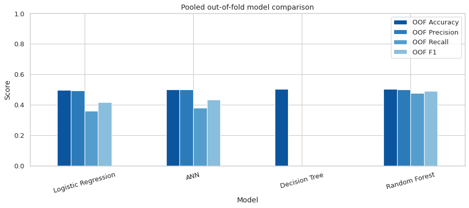

# Oral Cancer Research Dashboard

A blue-and-white **Streamlit research dashboard** for inspecting an oral cancer classification experiment, comparing four models and understanding the effect of removing diagnosis-related information from model inputs.

**This is an educational research project, not a diagnostic application.** The corrected experiment does not demonstrate useful predictive performance.



## Features

- Study overview and recorded diagnosis distribution
- Dataset exploration with country, age and diagnosis filters
- Interactive model and metric comparisons across 12 folds
- Full out-of-fold classification reports and confusion matrices
- ANN training histories and final-fold tree visualizations
- CSV downloads, methodology and source fingerprints
- Cached data loading, explicit UTF-8 text reading and safe report parsing

## Verified results

84,922 observations · 15 candidate features · 12 stratified folds · 4 models

| Model | Pooled OOF accuracy |
|---|---:|
| Logistic Regression | 49.67% |
| Artificial Neural Network | 50.08% |
| Decision Tree | 50.13% |
| Random Forest | 50.18% |

The majority-class reference is **50.13%**. The fixed Decision Tree predicts only the majority class and has **0% Cancer recall**. The small accuracy differences do not establish model superiority. Model results are taken from the executed corrected notebook; no values are fabricated. Table exports preserve the notebook's six-decimal display precision.

## Why preprocessing matters

The earlier input set included `Treatment Type`, which strongly reveals the recorded diagnosis. A simple treatment-based rule reached about 90.06% on this dataset, without demonstrating pre-diagnosis prediction. The corrected experiment excludes treatment, cost, stage, survival, lost workdays, early-diagnosis and tumor-size fields under a pre-diagnosis prediction assumption. ID and Country are also excluded. It preserves valid zeros, checks categories, fits scaling within each training fold and evaluates every row using out-of-fold predictions. All models use the same candidate features and fold indices.

Dataset provenance and feature collection timing remain unverified. The results are conditional on the supplied data and fixed model settings.

## Quick start — Windows / Anaconda

Extract the repository folder, then open Anaconda Prompt:

```bat
conda create -n oral-dashboard python=3.11 -y
conda activate oral-dashboard
cd /d "C:\path\to\oral-cancer-research-dashboard"
python -m pip install -r requirements.txt
```

Copy your original `oral_cancer_prediction_dataset.csv` to `data/`. It is excluded from Git by default. Then:

```bat
python -m streamlit run app.py
```

Open http://localhost:8501. Stop the server with Ctrl+C. TensorFlow is not needed to run the dashboard. Installation and rerunning the research notebook are described inside the notebook. Run that notebook with the original CSV beside it, or update its DATA_PATH to `data/oral_cancer_prediction_dataset.csv`.

## Repository contents

| Path | Purpose |
|---|---|
| `app.py` | Streamlit dashboard |
| `requirements.txt` | Tested dashboard dependency versions |
| `.streamlit/config.toml` | Theme and server configuration |
| `data/` | Saved metrics, reports, fingerprints and data instructions |
| `assets/` | Actual figures from the corrected notebook |
| `finished_assignment_corrected.ipynb` | Executed research notebook |
| `tests/test_bundle.py` | Dataset-independent bundle checks |
| `GITHUB_UPLOAD.md` | First-upload instructions |

## Validation

All corrected notebook code cells executed in a fresh IPython process; 48 model/fold fits completed. Streamlit AppTest passed six pages, country/diagnosis/age filters, empty states, all model reports and all diagnostic views using the original dataset. The UTF-8 report fix was retested. Windows execution and browser visual QA were not performed in the development environment.

Run the repository's lightweight checks without the private dataset:

```bat
python -m unittest discover -s tests -v
```

## Limitations

- No independent external cohort or verified patient-group structure was supplied.
- Unique IDs do not prove independent observations.
- Features must actually be available at prediction time; the source has not established that timing.
- There is no hyperparameter search or new patient prediction endpoint.
- Dashboard filters change exploratory views, not the global model scores.
- Saved metrics cannot be reused with a replacement dataset.

## Data and licensing

The raw CSV is omitted because its redistribution terms have not been supplied. See [data instructions](data/README.md). Confirm terms for the data and derived results before a public release. No software license has been assigned; add a license you are authorized to grant after confirming ownership of the group assignment. A private GitHub repository is a suitable initial destination while these details are resolved.
